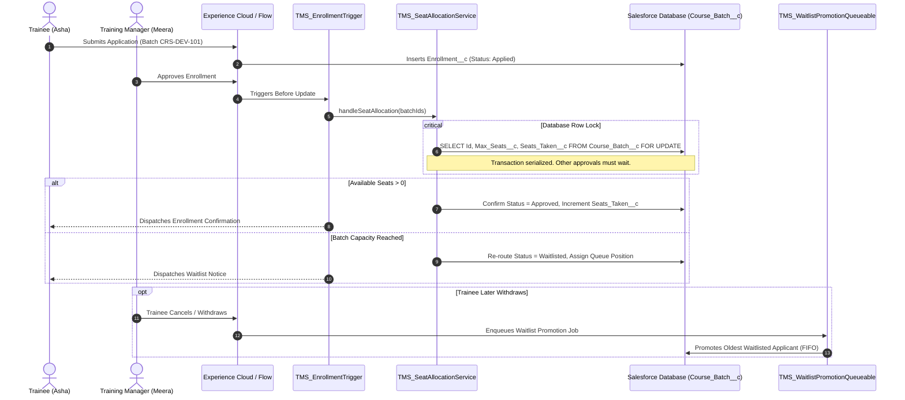
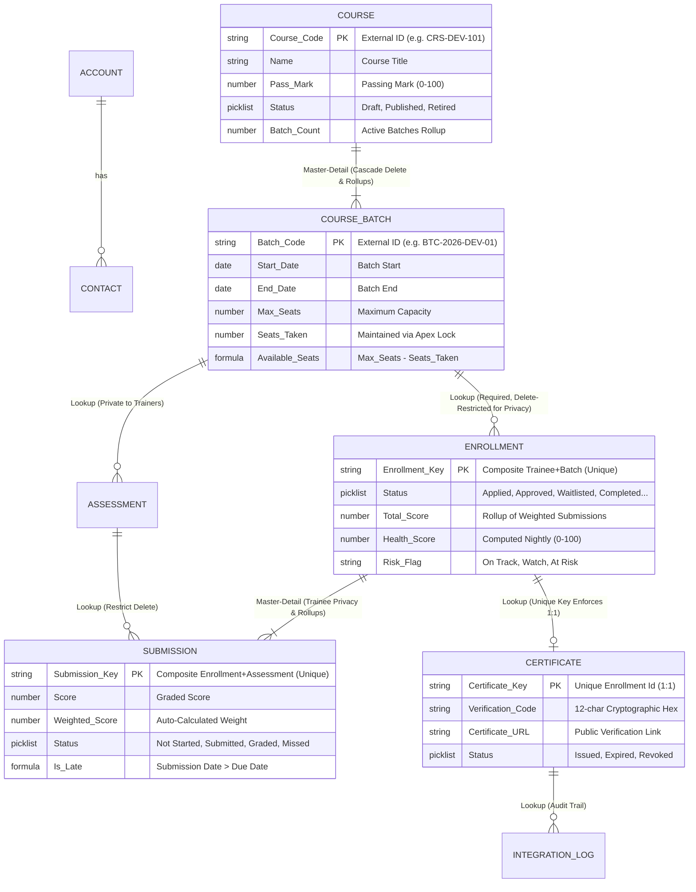

<div align="center">

*ENTERPRISE CLOUD ARCHITECTURE &bull; COGNIZANT HACKATHON MASTER SOLUTION BRIEF*

# 🎓 Training Management System (TMS)

### An Autonomous, Concurrency-Safe Corporate Academy Platform Built Natively on Salesforce

[](https://developer.salesforce.com/)
[-2ea44f?style=for-the-badge&logo=checkmarx&logoColor=white)](./force-app/main/default/classes)
[](./docs/TMS_FINAL_EXECUTIVE_DOCUMENTATION.md)
[](./Training%20Management%20System%20(TMS)%20Final%20Design%20Document.pdf)
[](./Training%20Management%20System%20(TMS)%20Final%20Design%20Document.pdf)
[](./LICENSE)

<p align="center">
  <a href="#-project-overview">Overview</a> &bull;
  <a href="#-technology-stack">Tech Stack</a> &bull;
  <a href="#-architecture--workflow">Architecture</a> &bull;
  <a href="#-data-model--schema">Data Model</a> &bull;
  <a href="#-project-structure">Codebase Map</a> &bull;
  <a href="#-features--technical-highlights">Technical Highlights</a> &bull;
  <a href="#-installation--setup">Setup Guide</a> &bull;
  <a href="#-executive-documentation">Documentation</a>
</p>

---

</div>

| Primary Architecture | Quality & Regression Verification | Core Target Environment |
| :--- | :--- | :--- |
| **Philosophy:** Clicks-Before-Code (80% Native / 20% Apex)<br/>**Framework:** Experience Cloud + Flow + Enterprise Apex<br/>**Security:** Strict RBAC, Zero-PII Public Whitelist | **Unit Tests:** 66 / 66 Passing (100% Pass Rate)<br/>**Org Code Coverage:** 84% Total (Threshold: 75%)<br/>**Regression:** Full 10-Point Architectural Audit Verified | **Platform:** Salesforce Developer Edition<br/>**CLI Engine:** Salesforce CLI (`sf`) v65.0<br/>**Portal Runtime:** LWR / Experience Cloud |

---

## 📖 Project Overview

The **Training Management System (TMS)** is a modern enterprise learning and certification platform engineered natively on the Salesforce platform. Designed to eliminate operational overhead and administrative chaos in corporate upskilling programs, TMS transforms training operations from fragile spreadsheets and untracked emails into a self-governing, autonomous academy.

> [!NOTE]
> **Executive Pitch:** *TMS is an autonomous corporate academy. It fills classroom seats fairly, rescues at-risk learners before they fail, and issues tamper-proof digital credentials anyone can verify in seconds.*

```
Corporate Training Inefficiencies                  TMS Autonomous Solution
┌─────────────────────────────────┐               ┌─────────────────────────────────┐
│ • Fragmented email applications │               │ • Self-Service LWR Portal       │
│ • Accidental seat over-booking  │   ───────►    │ • SELECT FOR UPDATE Row Locking │
│ • Untracked student attrition   │               │ • Nightly Learner Health Batch  │
│ • Forgable static certificates  │               │ • Zero-PII Cryptographic QR Auth│
└─────────────────────────────────┘               └─────────────────────────────────┘
```

### The Problem Addressed
* **The Spreadsheet Bottleneck:** Course offerings, enrollment quotas, and schedules are typically fragmented across disparate spreadsheets and manager inboxes.
* **Concurrency Overbooking:** Popular batches suffer from simultaneous approvals where two managers confirm the final available seat at the same second, resulting in double-booked classrooms.
* **Invisible Learner Attrition:** Trainees quietly fall behind on assignments with zero early warning; instructors only discover failing performance after final cohort deadlines have passed.
* **Credential Fraud & Slow Verification:** Paper and static PDF certificates are trivial to forge, and third-party auditors or clients waste days attempting to validate employee qualifications.

### Primary Objectives & Capabilities
* **Fair, Concurrency-Safe Admissions:** Implements pessimistic database locks (`SELECT FOR UPDATE`) to guarantee zero overbooking during simultaneous manager approvals, coupled with an automated FIFO waitlist promotion engine.
* **Early Warning Learner Health Radar:** Executes a nightly batch heuristic (0–100 score) categorizing trainees into `On Track`, `Watch`, and `At Risk` tiers, triggering automated instructor intervention.
* **Inline Trainer Cockpit:** Equips instructors with a streamlined Lightning Web Component to review submissions, grade with real-time score calculation, and trigger idempotent cohort completion.
* **Tamper-Proof Digital Credentials:** Generates unguessable 12-character cryptographic verification tokens and embeds zero-PII QR codes verified instantly via a public, unauthenticated REST API.

---

## 🛠️ Technology Stack

TMS leverages the modern Salesforce ecosystem combined with Python report compilation tooling:

<div align="center">
  <a href="https://skillicons.dev">
    
  </a>
</div>

<br/>

| Tier | Technologies Used | Architectural Responsibility |
| :--- | :--- | :--- |
| **Presentation Tier** | **Lightning Web Components (LWC)**, HTML5, CSS3, Lightning Design System (SLDS), Wire Service | Responsive learner portal, trainer grading cockpit, risk radar cards, and public verification widgets. |
| **Portal Infrastructure**| **Salesforce Experience Cloud**, LWR Site Runtime, Communities, Public Guest Profiles | Secure external self-service access for Trainees, Trainers, and Public Verifiers with granular Sharing Sets. |
| **Declarative Logic** | **Salesforce Flow** (Record-Triggered & Screen Flows), Approval Processes, 13 Validation Rules | Status defaults, pre-generating submission rows, withdrawal handling, guided revocation, and strict input validation. |
| **Algorithmic Core** | **Apex (API v65.0)**, Trigger Handler Framework, Asynchronous Queueables, Batch Apex, `System.Finalizer` | Pessimistic seat locking (`SELECT FOR UPDATE`), bulk cohort completion, nightly risk calculation, and fail-safe recovery. |
| **Integration Layer** | **Named Credentials**, External Microservice Callouts, Inbound Apex REST (`/tms/verify/*`), Platform Events | Zero-PII QR code rendering, unauthenticated public credential lookup, and decoupled trainee notification events. |
| **Document Generation**| **Visualforce** (`renderAs="pdf"`), **Python 3**, **ReportLab Platypus** | Server-side official PDF certificates and automated generation of 6-page publication-quality executive consulting documents. |

---

## 🏛️ Architecture and Workflow

TMS adheres strictly to the **"Clicks-Before-Code"** hierarchy: 80% of business logic is handled via native declarative tools (Validation Rules, Record-Triggered Flows, Screen Flows, Sharing Sets), while Apex is surgically applied strictly where declarative tools hit platform limits.

### High-Level System Architecture

```mermaid
graph TB
    subgraph Presentation_Layer["Presentation Layer (Experience Cloud & Lightning Experience)"]
        LWC1["tmsMyLearning<br/>(Learner Dashboard)"]
        LWC2["tmsTrainerCockpit<br/>(Grading Workspace)"]
        LWC3["tmsCertificateViewer<br/>(Printable Credential)"]
        LWC4["tmsLearnerRiskCard<br/>(Risk Radar)"]
        LWC5["tmsCertificateVerify<br/>(Public Lookup)"]
        DASH["TMS Executive Operations Dashboard<br/>(12-Column Responsive Grid)"]
    end

    subgraph Business_Automation_Layer["Business Automation & Flow Orchestration (Declarative 80%)"]
        VR["13 Validation Rules<br/>(With Bypass Permission)"]
        RTF["Record-Triggered Flows<br/>(Defaults & Submission Scoring)"]
        SCF["Screen Flows<br/>(Apply, Withdraw, Finalize, Revoke)"]
        APPR["2-Step Approval Process<br/>(Manager Evaluation)"]
    end

    subgraph Apex_Service_Layer["Apex Engine & Algorithmic Core (Programmatic 20%)"]
        LOCK["TMS_SeatAllocationService<br/>(SELECT FOR UPDATE Locking)"]
        COMP["TMS_CompletionQueueable<br/>(Idempotent Bulk Completion)"]
        BATCH["TMS_LearnerHealthBatch<br/>(Nightly 0-100 Risk Scoring)"]
        CRON["TMS_NightlyScheduler<br/>(Master Cron at 2:00 AM)"]
        FIN["TMS_CertificateFinalizer<br/>(System.Finalizer Recovery)"]
    end

    subgraph Integration_Security_Layer["Integration, Security & External Delivery Layer"]
        NC["Named Credential<br/>(callout:TMS_QR_Service)"]
        REST["Public Apex REST Endpoint<br/>(/services/apexrest/tms/verify/*)"]
        PE["Platform Events<br/>(Certificate_Issued__e)"]
        SEC["Granular RBAC<br/>(3 Custom Perms, 5 Perm Sets, 3 Groups)"]
    end

    Presentation_Layer --> Business_Automation_Layer
    Business_Automation_Layer --> Apex_Service_Layer
    Apex_Service_Layer --> Integration_Security_Layer
```



---

### Concurrency-Safe Seat Allocation Workflow

When two managers review applicants for the final seat simultaneously, standard Salesforce flows would experience a race condition. TMS serializes transactions at the database level:



---

## 🗄️ Data Model & Schema

The relational architecture balances data isolation, privacy boundaries, and calculation roll-ups across six core custom objects, two platform events, and one custom metadata type.



### Strategic Architectural Decisions

> [!IMPORTANT]
> **Why is `Course_Batch__c` to `Enrollment__c` a Lookup instead of Master-Detail?**  
> In Salesforce, a Master-Detail child inherits the sharing and security model of its parent. Because Course Batches must be publicly visible to all community members, making Enrollment a Master-Detail child would expose every trainee's personal enrollment, progress, and contact details to all other trainees. Using a restricted Lookup maintains strict data privacy, with seat counts maintained reliably via Apex pessimistic locking.

---

## 📂 Project Structure

A clean, modular directory structure aligned with Salesforce DX standards and enterprise separation of concerns:

```text
tms/
├── force-app/main/default/               # Salesforce DX Source Directory
│   ├── classes/                          # Enterprise Apex Classes & Unit Tests (26 classes)
│   │   ├── TMS_Constants.cls             # System-wide string constants & status dictionary
│   │   ├── TMS_TriggerHandler.cls        # Virtual base trigger handler framework
│   │   ├── TMS_EnrollmentTriggerHandler.cls # Enrollment lifecycle trigger handler
│   │   ├── TMS_SeatAllocationService.cls # Pessimistic row locking (SELECT FOR UPDATE)
│   │   ├── TMS_SeatAllocationServiceTest.cls # Concurrency & seat capacity unit tests
│   │   ├── TMS_WaitlistPromotionQueueable.cls# Asynchronous FIFO waitlist promotion
│   │   ├── TMS_CompletionQueueable.cls   # Idempotent cohort completion & 12-char hex generator
│   │   ├── TMS_CompletionQueueableTest.cls # Grading & completion engine unit tests
│   │   ├── TMS_LearnerHealthBatch.cls    # Nightly 0-100 multi-factor risk scoring batch
│   │   ├── TMS_LearnerHealthBatchTest.cls# Risk scoring & threshold unit tests
│   │   ├── TMS_NightlyScheduler.cls      # Master cron scheduler (2:00 AM sweeps)
│   │   ├── TMS_LearningController.cls    # Unified @AuraEnabled backend for all LWCs
│   │   ├── TMS_LearningControllerTest.cls# Controller security & data access tests
│   │   ├── TMS_CertificateService.cls    # Certificate orchestration & expiration sweeper
│   │   ├── TMS_CertificateServiceTest.cls# Issuance & revocation unit tests
│   │   ├── TMS_CertificateIssueQueueable.cls # Zero-PII QR code callout & ContentVersion engine
│   │   ├── TMS_CertificateIssueQueueableTest.cls # QR integration unit tests
│   │   ├── TMS_CertificateFinalizer.cls  # System.Finalizer recovery for queueable timeouts
│   │   ├── TMS_CertificateVerifyResource.cls # Inbound public REST API (/tms/verify/*)
│   │   ├── TMS_CertificateVerifyResourceTest.cls # REST whitelist & authentication tests
│   │   ├── TMS_GuestEnrollmentAction.cls # Invocable action for guest portal registration
│   │   ├── TMS_GuestEnrollmentActionTest.cls # Guest registration unit tests
│   │   ├── TMS_HousekeepingService.cls   # Nightly maintenance for stale records & logs
│   │   ├── TMS_HousekeepingServiceTest.cls # Housekeeping sweeps unit tests
│   │   ├── TMS_SubmissionScoringTest.cls # Submission calculation & weightage tests
│   │   └── TMS_HttpCalloutMock.cls       # HTTP mock for external QR microservice
│   ├── triggers/                         # Apex Triggers
│   │   └── TMS_EnrollmentTrigger.trigger # Single trigger on Enrollment__c object
│   ├── lwc/                              # Lightning Web Components Suite (8 components)
│   │   ├── tmsMyLearning/                # Trainee portal dashboard (progress, courses, certs)
│   │   ├── tmsTrainerCockpit/            # Trainer grading workspace with inline scoring sliders
│   │   ├── tmsCertificateViewer/         # Digital certificate viewer with print stylesheet
│   │   ├── tmsCertificateVerify/         # Public verification widget for credentials
│   │   ├── tmsLearnerRiskCard/           # Real-time learner risk radar card
│   │   ├── tmsCourseEnrollment/          # Course catalog browser & batch application
│   │   ├── tmsGuestEnrollment/           # Self-service guest portal registration modal
│   │   └── tmsPortalAccess/              # Experience Cloud persona gateway & switchboard
│   ├── flows/                            # Declarative Salesforce Flows (8 flows)
│   │   ├── TMS_Assessment_RT_BeforeSave_Defaults.flow-meta.xml
│   │   ├── TMS_Assessment_RT_AfterSave_Orchestrate.flow-meta.xml
│   │   ├── TMS_Submission_RT_BeforeSave_Scoring.flow-meta.xml
│   │   ├── TMS_Certificate_PE_Notify.flow-meta.xml
│   │   ├── TMS_SCR_Apply_For_Batch.flow-meta.xml
│   │   ├── TMS_SCR_Withdraw_Enrollment.flow-meta.xml
│   │   ├── TMS_SCR_Finalize_Batch.flow-meta.xml
│   │   └── TMS_SCR_Certificate_Revoke.flow-meta.xml
│   ├── objects/                          # Custom Objects, Fields & Platform Events
│   │   ├── Course__c/                    # Course catalog & requirements
│   │   ├── Course_Batch__c/              # Cohort schedules & seat quotas
│   │   ├── Enrollment__c/                # Trainee batch enrollments & health scores
│   │   ├── Assessment__c/                # Assignments, quizzes & project specs
│   │   ├── Submission__c/                # Trainee work deliverables & graded scores
│   │   ├── Certificate__c/               # Verified credentials & cryptographic tokens
│   │   ├── Integration_Log__c/           # Outbound integration audit trails
│   │   ├── Certificate_Issued__e/        # Real-time notification platform event
│   │   ├── Training_Certificate_Issued__e/ # High-volume platform event
│   │   ├── TMS_Config__mdt/              # Custom metadata for SLAs & chunk thresholds
│   │   └── Contact/                      # Trainee and Trainer extensions
│   ├── permissionsets/                   # Granular RBAC Permission Sets (6 sets)
│   ├── permissionsetgroups/              # Role-Based Permission Set Groups (3 groups)
│   ├── customPermissions/                # Granular Action Permissions (3 permissions)
│   ├── namedCredentials/                 # Zero-PII QR code endpoint definition
│   ├── remoteSiteSettings/               # Whitelisted external integration endpoints
│   ├── pages/                            # Visualforce Server-Side PDF Template
│   │   └── TMS_CertificatePDF.page       # Official gold-seal academic certificate
│   ├── dashboards/                       # Executive Training Management Dashboard
│   ├── reports/                          # 5 Operational & Governance Reports
│   ├── digitalExperiences/ & sites/      # Experience Cloud LWR Site (TMS Academy)
│   └── approvalProcesses/                # Two-step manager enrollment approval workflow
├── manifest/                             # Deployment Package Manifests
│   ├── package.xml                       # Master manifest covering all 5 implementation days
│   ├── package-day1.xml                  # Day 1: Schema, Security & Seed Data
│   ├── package-day2.xml                  # Day 2: Automations, Triggers & Seat Locking
│   ├── package-day3.xml                  # Day 3: Completion Engine, Risk Batch & LWCs
│   ├── package-day4.xml                  # Day 4: QR Integration, REST API & Dashboards
│   └── package-day5.xml                  # Day 5: Regression Suite & Governance Flows
├── data/                                 # Seed Data CSVs for Rapid Setup
│   ├── contacts.csv                      # Sample Trainees and Instructors
│   ├── courses.csv                       # Technical, Compliance & Leadership Courses
│   └── course_batches.csv                # Active and upcoming cohort schedules
├── docs/                                 # Project Documentation & Artifacts
│   ├── TMS_FINAL_EXECUTIVE_DOCUMENTATION.md # Comprehensive 560-line consulting whitepaper
│   ├── TMS_Day_1_Documentation.pdf to ... # Publication-ready milestone PDFs
│   ├── TMS_Final_Executive_Documentation.pdf # Master 6-page executive PDF
│   └── TMS_Final_Executive_Documentation_page-1.png to page-6.png # High-res page previews
├── generate_day1_pdf.py to ...           # Python ReportLab Platypus PDF generator scripts
├── generate_final_consulting_pdf.py      # Master ReportLab PDF compilation script
├── sfdx-project.json                     # Salesforce DX project configuration
└── .gitignore                            # Salesforce, Python, IDE & OS exclusions
```

---

## 🚀 Features & Technical Highlights

### 1. Concurrency-Safe Seat Allocation (`SELECT FOR UPDATE`)
* **Problem:** Simultaneous approvals by two managers for the final available seat evaluate remaining capacity concurrently, resulting in double-booking.
* **Engineering Solution:** `TMS_SeatAllocationService.cls` executes a pessimistic database lock on `Course_Batch__c` using `FOR UPDATE`. This forces simultaneous transactions into a serialized queue: the first receives the seat (`Approved`), while the second is automatically diverted to `Waitlisted` with a sequential queue number.

### 2. Multi-Factor Learner Health Radar (`TMS_LearnerHealthBatch.cls`)
* **Problem:** Trainees who miss early assignments often disengage completely before trainers realize they are struggling.
* **Engineering Solution:** Scheduled daily at 2:00 AM, this batch evaluates submissions against an algorithmic 100-point rubric:
  * **On Track (70–100 pts):** Assignments up to date, weighted grade average above passing threshold.
  * **Watch (40–69 pts):** One overdue submission or borderline cumulative grade.
  * **At Risk (<40 pts):** Multiple missed assignments or critical scoring failure. Instructors receive immediate cockpit alerts.

### 3. Zero-PII Cryptographic Digital Credentialing
* **Public Endpoint Security:** The public verification REST API (`/services/apexrest/tms/verify/*`) queries certificates using an unguessable 12-character cryptographic hexadecimal token (`Verification_Code__c`).
* **Strict Whitelist:** The endpoint returns strictly four non-sensitive fields: `certificateNumber`, `courseName`, `issueDate`, and `status`. Trainee names, email addresses, employee IDs, and grade percentages are never exposed publicly.

### 4. Resilient Asynchronous Architecture & Fail-Safe Recovery
* **Problem:** Performing HTTP callouts after uncommitted database writes triggers Salesforce `CalloutException`.
* **Engineering Solution:** Outbound QR code generation is isolated inside an asynchronous Queueable (`TMS_CertificateIssueQueueable.cls`).
* **Crash Recovery:** Implements `System.Finalizer` via `TMS_CertificateFinalizer.cls`. If an unhandled timeout or callout failure occurs, the finalizer traps the exception, logs diagnostic stack traces into `Integration_Log__c`, and safely sets the certificate status to `Failed` for automatic nightly retry.

---

## ⚡ Installation and Setup

Follow these verified steps to deploy TMS to your Salesforce environment:

### Prerequisites
* [Salesforce CLI (`sf`)](https://developer.salesforce.com/tools/salesforcecli) installed and authenticated.
* A Salesforce Developer Edition or Scratch Org (API Version 65.0+).
* Python 3.8+ with `reportlab` (optional, for regenerating documentation PDFs).

### Step 1: Clone Repository & Authenticate Org
```bash
# Clone the repository
git clone https://github.com/infyier/salesforce-training-management-system.git
cd salesforce-training-management-system

# Authorize your target Salesforce org
sf org login web --alias tmsOrg --set-default
```

### Step 2: Deploy Metadata Manifest
Deploy the complete 5-day enterprise package using the consolidated manifest:
```bash
sf project deploy start --manifest manifest/package.xml --target-org tmsOrg
```

### Step 3: Load Seed Data
Import baseline courses, contacts, and batches:
```bash
# 1. Import Courses
sf data import tree --files data/courses.csv --target-org tmsOrg

# 2. Upsert Contacts (Trainees & Trainers)
sf data upsert bulk --sobject Contact --file data/contacts.csv --external-id Employee_ID__c --target-org tmsOrg

# 3. Upsert Course Batches
sf data upsert bulk --sobject Course_Batch__c --file data/course_batches.csv --external-id Batch_Code__c --target-org tmsOrg
```

### Step 4: Assign Permission Set Groups
Assign the appropriate permission group based on user role:
```bash
# Assign Training Manager Access to Admin User
sf org assign permsetgroup --name TMS_Manager_Access --target-org tmsOrg

# Assign Trainer Access
sf org assign permsetgroup --name TMS_Trainer_Access --target-org tmsOrg

# Assign Trainee Access
sf org assign permsetgroup --name TMS_Trainee_Access --target-org tmsOrg
```

### Step 5: Execute Regression Test Suite
Verify that all unit tests pass with >75% org coverage:
```bash
sf apex run test --test-level RunLocalTests --code-coverage --result-format human --target-org tmsOrg
```

---

## 💻 Usage and Execution

### Persona Walkthroughs

| Persona | Interface | Key Operational Actions |
| :--- | :--- | :--- |
| **🎓 Trainee (Asha)** | Experience Cloud Portal | Browse active courses, submit one-click batch applications, upload assignment URLs/text, and download verified certificates. |
| **👨‍🏫 Trainer (Ravi)** | Trainer Cockpit LWC | Monitor cohort rosters, review at-risk learner radar flags, evaluate submissions with inline scoring sliders, and trigger cohort completion. |
| **📋 Manager (Meera)** | Lightning Management App | Publish courses, evaluate applications, inspect the 12-column Executive Dashboard, and revoke compromised certificates. |
| **🔍 Verifier (Vikram)** | Public REST API / Web | Scan mobile QR code or visit `/services/apexrest/tms/verify/{code}` for instant zero-PII certificate verification in <2 seconds. |

### Testing Public REST Verification Endpoint
To test the unauthenticated certificate verification endpoint via cURL:
```bash
curl -X GET "https://<YOUR_INSTANCE_URL>/services/apexrest/tms/verify/A1B2C3D4E5F6" \
  -H "Content-Type: application/json"
```

**Expected JSON Response (Zero PII):**
```json
{
  "isValid": true,
  "certificateNumber": "CERT-2026-0001",
  "courseName": "Salesforce Apex & Architecture Essentials",
  "issueDate": "2026-11-01",
  "status": "Issued"
}
```

### Regenerating Publication Documentation PDFs
To regenerate the executive consulting whitepapers:
```bash
# Generate Master 6-Page Executive Whitepaper
python3 generate_final_consulting_pdf.py

# Generate individual sprint milestone reports
python3 generate_day1_pdf.py
python3 generate_day2_pdf.py
python3 generate_day3_pdf.py
python3 generate_day4_pdf.py
python3 generate_day5_pdf.py
```

---

## 📑 Executive Documentation Previews

The project includes an exhaustive 6-page Executive Consulting Whitepaper compiled adhering to the **Clean Document Standard**:

<div align="center">

| Page 1: Executive Summary & Rubric | Page 2: Problem & MoSCoW Backlog | Page 3: Modules & Concurrency Engine |
| :---: | :---: | :---: |
|  |  |  |

| Page 4: Schema ERD & Architecture | Page 5: 5-Day Agile Sprint Records | Page 6: Presentation Pitch Script |
| :---: | :---: | :---: |
|  |  |  |

</div>

Full high-resolution document: [`docs/TMS_Final_Executive_Documentation.pdf`](./docs/TMS_Final_Executive_Documentation.pdf)

---

## 🔮 Future Improvements

1. **Agentforce AI Learning Buddy:** Deploy an autonomous conversational agent inside Experience Cloud to recommend courses based on career goals and summarize assessment rubrics.
2. **Enterprise HRIS Webhooks:** Utilize the `Certificate_Issued__e` platform event to publish real-time outbound webhooks to Workday, SAP SuccessFactors, and ADP.
3. **Adaptive Assessments & Retake Paths:** Introduce an `Assessment_Attempt__c` child object to support multi-attempt grading policies and automated remediation paths for at-risk trainees.
4. **B2B Multi-Tenancy:** Leverage Account hierarchies to provide white-labeled training portals with corporate branding and segregated seat quotas.

---

## 🤝 Contributing & License

Contributions, feedback, and architecture enhancements are welcome! Please feel free to open an issue or submit a pull request.

> [!NOTE]
> **License:** This project is licensed under the **MIT License** - see the [LICENSE](./LICENSE) file for full details.